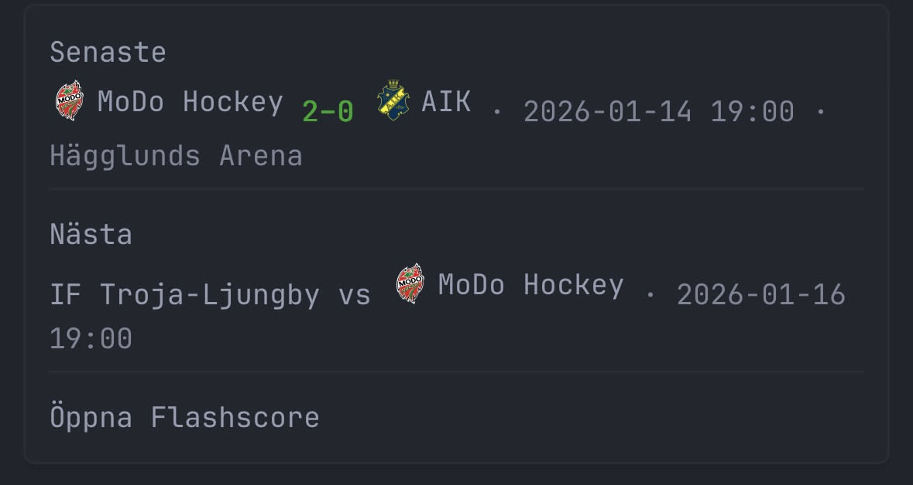

# 🏒 Hockey Schedule API

A small, self-hosted API that tells you **your team's last result and next game**, with team logos.

It reads the public schedule pages on [stats.swehockey.se](https://stats.swehockey.se) (SHL, HockeyAllsvenskan, SDHL, Hockeyettan and more), picks out the games for the team you choose, and returns them as simple JSON. It was built as a backend for a [Glance](https://github.com/glanceapp/glance) dashboard widget, but works with anything that can read JSON (Home Assistant, scripts, your own UI).



* Works for **any team** in any league listed on Swehockey, configured with environment variables only
* Returns the **last played game** (with win/loss/draw from your team's point of view) and the **next game**
* Adds **team logos** from [TheSportsDB](https://www.thesportsdb.com)
* Combines several schedules, e.g. regular season + playoffs
* Ready-made image: `ghcr.io/gshimself/hockey-api:latest`, runs as non-root

---

## 🚀 Getting started

### 1. Find your schedule URL(s)

1. Go to [stats.swehockey.se](https://stats.swehockey.se) and open the league your team plays in.
2. Open the **Schedule** (Spelschema) page for the current season.
3. Copy the URL. It looks like `https://stats.swehockey.se/ScheduleAndResults/Schedule/20962`.

Regular season and playoffs/qualifiers are usually separate schedules. Add all of them, separated by commas, and the API merges them.

> Schedule IDs change every season, so update the URLs when a new season starts.

### 2. Choose your team tag

`TEAM_TAG` is any part of your team's name as written on Swehockey (case-insensitive). A game is included if the tag appears in either team's name.

| `TEAM_TAG` | Matches                          |
| ---------- | -------------------------------- |
| `modo`     | "MoDo Hockey", "MODO Hockey Dam" |
| `löven`    | "IF Björklöven"                  |
| `aik`      | "AIK", "AIK Hockey"              |

Make the tag specific enough to only match your team.

### 3. Run it

```bash
docker run -d --name hockey-api \
  -p 8000:8000 \
  -e TEAM_TAG="modo" \
  -e SCHEDULE_URLS="https://stats.swehockey.se/ScheduleAndResults/Schedule/20962,https://stats.swehockey.se/ScheduleAndResults/Schedule/18267" \
  ghcr.io/gshimself/hockey-api:latest
```

Open <http://localhost:8000/team>. You should see your team's last and next game. If logos are missing, see [Team logos](#-team-logos).

For Docker Compose and Kubernetes, see [Deployment](#-deployment).

---

## ⚙️ Configuration

Everything is configured with environment variables.

| Variable | Default | Description |
| --- | --- | --- |
| `TEAM_TAG` | `modo` | Part of your team's name, case-insensitive. See [step 2](#2-choose-your-team-tag). |
| `SCHEDULE_URLS` | an SHL 2025/26 schedule | One or more Swehockey schedule URLs, separated by comma, semicolon or newline. **Set this.** |
| `SCHEDULE_URL` | – | Older name for `SCHEDULE_URLS`, still supported. Ignored if `SCHEDULE_URLS` is set. |
| `TEAM_NAME_OVERRIDES` | – | Fix logo lookups, e.g. `MoDo Hockey=Modo,Djurgårdens IF=Djurgarden`. See [Team logos](#-team-logos). |
| `THESPORTSDB_API_KEY` | `123` | TheSportsDB API key. The free key `123` works; set your own if you have one. |
| `SCHEDULE_CACHE_SECONDS` | `300` | How long fetched schedules are kept in memory. `0` fetches on every request. |
| `SCHEDULE_FETCH_RETRIES` | `2` | Attempts per schedule URL before giving up. |
| `SCHEDULE_FETCH_BACKOFF_SECONDS` | `0.5` | Wait between attempts (grows with each attempt). |
| `LOG_LEVEL` | `INFO` | Set to `DEBUG` to see which team TheSportsDB matched for each logo. |

Game times are always handled as Swedish local time, so you don't need to set `TZ` on the container.

---

## 🖼️ Team logos

Logos are looked up on TheSportsDB by the team name from Swehockey, and the first search hit is used. Usually this just works. When it doesn't (no logo, or the wrong team's logo), map the Swehockey name to a search term that TheSportsDB finds:

```
TEAM_NAME_OVERRIDES="MoDo Hockey=Modo,Djurgårdens IF=Djurgarden"
```

The left side is the name exactly as Swehockey writes it (case-insensitive). The right side is what is sent to TheSportsDB. You can test a search term in the browser: `https://www.thesportsdb.com/api/v1/json/123/searchteams.php?t=Modo`.

Logos found are remembered until the container restarts. Failed lookups (e.g. TheSportsDB being down) are retried on the next request.

---

## 📡 API

### `GET /team`

```json
{
  "team_tag": "modo",
  "team_name": "MoDo Hockey",
  "schedule_urls": [
    "https://stats.swehockey.se/ScheduleAndResults/Schedule/20962",
    "https://stats.swehockey.se/ScheduleAndResults/Schedule/18267"
  ],
  "warnings": [],
  "last_game": {
    "date": "2025-11-26",
    "time": "19:00",
    "home_team": "AIK",
    "away_team": "MoDo Hockey",
    "home_score": 1,
    "away_score": 2,
    "venue": "Hovet, Johanneshov",
    "round_detail": "",
    "home_badge": "https://r2.thesportsdb.com/images/media/team/badge/aik.png",
    "away_badge": "https://r2.thesportsdb.com/images/media/team/badge/modo.png",
    "team_result": "win"
  },
  "next_game": {
    "date": "2025-11-28",
    "time": "19:00",
    "home_team": "MoDo Hockey",
    "away_team": "IF Björklöven",
    "home_score": null,
    "away_score": null,
    "venue": "Hägglunds Arena",
    "round_detail": "",
    "home_badge": "https://r2.thesportsdb.com/images/media/team/badge/modo.png",
    "away_badge": "https://r2.thesportsdb.com/images/media/team/badge/bjorkloven.png"
  }
}
```

| Field | Description |
| --- | --- |
| `team_name` | Your team's full name as written on Swehockey (falls back to `team_tag`). |
| `warnings` | Normally empty. Lists schedule URLs that could not be fetched, or notes that an older cached schedule is being shown. |
| `date`, `time` | Swedish local time, `YYYY-MM-DD` and `HH:MM`. |
| `home_score`, `away_score` | `null` for games not played yet. |
| `round_detail` | Playoff round as written by Swehockey (e.g. `Kvartsfinal 2`), otherwise empty. |
| `home_badge`, `away_badge` | Logo URLs, or `null` if no logo was found. |
| `team_result` | Only on `last_game`: `win`, `loss` or `draw` for your team. |

**When there is no game to show**, the game object has empty strings and `null` values (check `date == ""`). This happens:

* for `last_game` when the most recent game is more than 31 days old, so last season's result isn't shown all summer;
* for `next_game` when the schedule has no unplayed games.

**Errors:** if none of the schedule URLs can be fetched and nothing is cached, the API returns HTTP `500` with the URLs and error messages. If at least one URL works, you get a normal response plus `warnings`.

### `GET /`

Health check. Returns `{"status": "ok", ...}`. Use it for liveness/readiness probes.

---

## 📦 Deployment

### Docker Compose

```yaml
services:
  hockey-api:
    image: ghcr.io/gshimself/hockey-api:latest
    restart: unless-stopped
    environment:
      TEAM_TAG: "modo"
      SCHEDULE_URLS: "https://stats.swehockey.se/ScheduleAndResults/Schedule/20962,https://stats.swehockey.se/ScheduleAndResults/Schedule/18267"
      TEAM_NAME_OVERRIDES: "MoDo Hockey=Modo"
    ports:
      - "8000:8000"
```

Run `docker compose up -d` and open <http://localhost:8000/team>.

### Kubernetes

Save as `k8s/hockey-api.yaml`. The same manifest works with GitOps tools like Argo CD or Flux. Commit it to the repo they sync from.

```yaml
apiVersion: v1
kind: Namespace
metadata:
  name: hockey
---
apiVersion: v1
kind: ConfigMap
metadata:
  name: hockey-api-config
  namespace: hockey
data:
  TEAM_TAG: "modo"
  SCHEDULE_URLS: "https://stats.swehockey.se/ScheduleAndResults/Schedule/20962,https://stats.swehockey.se/ScheduleAndResults/Schedule/18267"
  TEAM_NAME_OVERRIDES: "MoDo Hockey=Modo"
---
apiVersion: apps/v1
kind: Deployment
metadata:
  name: hockey-api
  namespace: hockey
spec:
  replicas: 1
  selector:
    matchLabels:
      app: hockey-api
  template:
    metadata:
      labels:
        app: hockey-api
    spec:
      containers:
        - name: hockey-api
          image: ghcr.io/gshimself/hockey-api:latest
          imagePullPolicy: Always
          ports:
            - containerPort: 8000
          securityContext:
            runAsNonRoot: true
            allowPrivilegeEscalation: false
            readOnlyRootFilesystem: true
            capabilities:
              drop: ["ALL"]
            seccompProfile:
              type: RuntimeDefault
          envFrom:
            - configMapRef:
                name: hockey-api-config
          readinessProbe:
            httpGet:
              path: /
              port: 8000
            initialDelaySeconds: 5
            periodSeconds: 10
          livenessProbe:
            httpGet:
              path: /
              port: 8000
            initialDelaySeconds: 15
            periodSeconds: 20
---
apiVersion: v1
kind: Service
metadata:
  name: hockey-api
  namespace: hockey
spec:
  selector:
    app: hockey-api
  ports:
    - name: http
      port: 8000
      targetPort: 8000
  type: ClusterIP
```

If you use your own TheSportsDB key, put it in a Secret and add it to the container with `secretRef` under `envFrom`.

```bash
kubectl apply -f k8s/hockey-api.yaml
kubectl -n hockey rollout status deploy/hockey-api

# Test it
kubectl -n hockey port-forward svc/hockey-api 8000:8000
curl http://localhost:8000/team
```

Inside the cluster the API is reachable at `http://hockey-api.hockey.svc.cluster.local:8000`, or `http://hockey-api:8000` from the same namespace. To reach it from outside, add an Ingress for the `hockey-api` service on port `8000`.

To pick up a new `latest` image: `kubectl -n hockey rollout restart deployment/hockey-api`. To control upgrades yourself, use a version tag instead, e.g. `ghcr.io/gshimself/hockey-api:v1.2.0`.

---

## 🖥️ Glance widget

A complete [Glance](https://github.com/glanceapp/glance) `custom-api` widget with logos and colour-coded results. Change `url` to wherever the API runs (e.g. `http://localhost:8000/team`), and adapt the title and the link at the bottom to your team.

```yaml
- type: custom-api
  title: MODO - Matches
  cache: 30m
  url: http://hockey-api:8000/team
  template: |
    {{ $lastDate := .JSON.String "last_game.date" }}
    {{ $nextDate := .JSON.String "next_game.date" }}

    {{ $lastHomeBadge := .JSON.String "last_game.home_badge" }}
    {{ $lastAwayBadge := .JSON.String "last_game.away_badge" }}
    {{ $nextHomeBadge := .JSON.String "next_game.home_badge" }}
    {{ $nextAwayBadge := .JSON.String "next_game.away_badge" }}

    {{ $teamResult := .JSON.String "last_game.team_result" }}

    <style>
      .team { display: inline-flex; align-items: center; gap: .3rem; }
      .muted2 { opacity: .8; }
      ul.fixtures { list-style: none; padding-left: 0; margin: .25rem 0 0; }
      ul.fixtures li { margin: .25rem 0; }

      .team-logo {
        height: 18px;
        width: auto;
        border-radius: 3px;
      }

      .score {
        font-weight: 600;
      }

      .score.team-win {
        color: #29a329;
      }

      .score.team-loss {
        color: #cc0000;
      }

      .score.team-neutral {
        color: inherit;
      }
    </style>

    <div class="stack gap-2">

      <!-- LAST GAME -->
      <div>
        <p class="muted">Last game</p>
        <ul class="fixtures">
          {{ if ne $lastDate "" }}
            <li>
              {{ $lh := .JSON.String "last_game.home_team" }}
              {{ $la := .JSON.String "last_game.away_team" }}

              <span class="team">
                {{ if ne $lastHomeBadge "" }}
                  
                {{ end }}
                {{ $lh }}
              </span>

              <span class="score
                {{ if eq $teamResult "win" }} team-win
                {{ else if eq $teamResult "loss" }} team-loss
                {{ else }} team-neutral
                {{ end }}">
                {{ .JSON.Int "last_game.home_score" }}–{{ .JSON.Int "last_game.away_score" }}
              </span>

              <span class="team">
                {{ if ne $lastAwayBadge "" }}
                  
                {{ end }}
                {{ $la }}
              </span>

              <span class="muted2">
                · {{ .JSON.String "last_game.date" }} {{ .JSON.String "last_game.time" }} · {{ .JSON.String "last_game.venue" }}
              </span>
            </li>
          {{ else }}
            <li class="muted">No played match found.</li>
          {{ end }}
        </ul>
      </div>

      <hr style="margin: .5rem 0 1rem;" />

      <!-- NEXT GAME -->
      <div>
        <p class="muted">Next game</p>
        <ul class="fixtures">
          {{ if ne $nextDate "" }}
            <li>
              {{ $nh := .JSON.String "next_game.home_team" }}
              {{ $na := .JSON.String "next_game.away_team" }}

              <span class="team">
                {{ if ne $nextHomeBadge "" }}
                  
                {{ end }}
                {{ $nh }}
              </span>
              vs
              <span class="team">
                {{ if ne $nextAwayBadge "" }}
                  
                {{ end }}
                {{ $na }}
              </span>
              <span class="muted2">
                · {{ .JSON.String "next_game.date" }} {{ .JSON.String "next_game.time" }}
              </span>
            </li>
          {{ else }}
            <li class="muted">No upcoming matches found.</li>
          {{ end }}
        </ul>
      </div>

      <hr style="margin: .5rem 0 1rem;" />
      <a class="button" href="https://www.flashscore.se/lag/modo-hc/nwkwmtM7/resultat/"
         target="_blank">Open Flashscore</a>
    </div>
```

---

## 🔧 Troubleshooting

| Problem | What to do |
| --- | --- |
| `last_game` / `next_game` is empty | Check that `TEAM_TAG` matches the team name on Swehockey, and that `SCHEDULE_URLS` points to the **current** season. |
| Games from another team show up | Make `TEAM_TAG` more specific. |
| Missing or wrong logo | Add a `TEAM_NAME_OVERRIDES` entry. Set `LOG_LEVEL=DEBUG` to see what TheSportsDB matched. |
| HTTP 500 | No schedule URL could be fetched. The response and the logs show the error per URL. |
| `warnings` in the response | One of the schedule URLs is failing. The rest of the data is still valid. |

---

## 🛠️ Development

The whole service is a single file, `app.py` (FastAPI + BeautifulSoup + httpx).

```bash
pip install -r requirements-dev.txt
pytest
```

Tests run in GitHub Actions on every push and pull request. Pushing a `v*` tag runs the tests and, if they pass, builds and publishes the image to `ghcr.io/gshimself/hockey-api` as both `latest` and the tag name.

Pull requests and issues are welcome. Ideas: multi-team support (`/team/{tag}`), logo provider fallbacks, automatic schedule discovery.

---

## 📄 License

MIT. You are free to use, modify and distribute.
